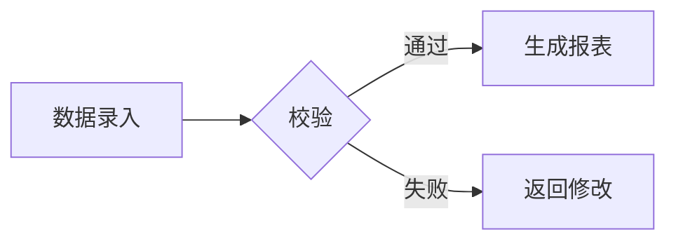

# 表格显示测试 · Table Display Test

> 本文件用于测试 mdEditor 的表格渲染能力，覆盖各种内容形态。
> 在 mdEditor 中打开后，重点验证：列宽自适应（编辑视图 + PDF 导出）、对齐、行内格式、代码、数学、图片、列表、引用、脚注、合并单元格等。
> 标注 `【mdEditor 专属】` 的项依赖本编辑器的扩展能力；其余为 GFM 标准表格。

---

## 1. 基础对齐（左 / 中 / 右）

| 左对齐 | 居中 | 右对齐 |
|:-------|:----:|-------:|
| 苹果   | 🍎  |  ¥12.50 |
| 香蕉   | 🍌  | ¥ 8.00 |
| 西瓜   | 🍉  | 99.990 |

---

## 2. 行内文本格式

| 类型 | 示例 | 说明 |
|:-----|:-----|:-----|
| 粗体 | **这是粗体** | `**text**` |
| 斜体 | *这是斜体* | `*text*` |
| 删除线 | ~~已删除~~ | `~~text~~` |
| 高亮 | ==高亮文本== | `==text==` 【mdEditor 专属】 |
| 混合 | **粗体** 中包含 *斜体* 与 ~~删除~~ | 嵌套组合 |
| 上标/下标 | H~2~O 与 x^2^ | `~x~` / `^x^` 【mdEditor 专属】 |

---

## 3. 行内代码与特殊字符

| 场景 | 内容 | 说明 |
|:-----|:-----|:-----|
| 普通行内代码 | `print("hello")` | 反引号包裹 |
| 含反引号 | `` `code` `` | 用双反引号包裹单反引号 |
| 含竖线 | `a \| b \| c` | 行内代码中竖线无需转义 |
| 含尖括号 | `<div>tag</div>` | HTML 标签作为代码文本 |
| 路径 | `C:\Users\Admin\file.md` | 反斜杠路径 |

---

## 4. 链接与图片

| 类型 | 内容 |
|:-----|:-----|
| 外部链接 | [mdEditor 仓库](https://github.com/yuansong/mdEditor) |
| 内部锚点 | [跳到本节](#8-多行与换行) |
| 带标题链接 | [百度](https://www.baidu.com "搜索引擎") |
| 自动链接 | <https://www.example.com> |
| 行内图片 |  |
| 图片+文字混排 | 见  右侧说明 |

> 注：图片为网络占位图，离线环境可能不显示，仅验证渲染占位逻辑。

---

## 5. 数学公式（KaTeX）【mdEditor 专属】

| 描述 | 公式 |
|:-----|:-----|
| 行内分数 | 勾股定理 $a^2 + b^2 = c^2$ 在几何中常用 |
| 行内求和 | 总和 $\sum_{i=1}^{n} i = \frac{n(n+1)}{2}$ |
| 行内积分 | 面积 $A = \int_{0}^{1} x^2 \, dx$ |
| 块级公式（单独成行） | $$E = mc^2$$ |
| 矩阵 | $\begin{bmatrix}1 & 0 \\ 0 & 1\end{bmatrix}$ |

---

## 6. 单元格内的列表

### 6.1 无序列表

| 分类 | 项 |
|:-----|:---|
| 水果 | - 苹果<br>- 香蕉<br>- 橙子 |
| 蔬菜 | * 番茄<br>* 黄瓜<br>* 菠菜 |

### 6.2 有序列表

| 步骤 | 操作 |
|:-----|:-----|
| 安装 | 1. 下载安装包<br>2. 双击运行<br>3. 完成向导 |
| 配置 | 1. 打开设置<br>2. 选择主题<br>3. 保存 |

### 6.3 任务列表（Github 风格，部分编辑器支持）

| 进度 | 任务 |
|:-----|:-----|
| 本周 | - [x] 写文档<br>- [x] 修 bug<br>- [ ] 写测试 |
| 下周 | - [ ] 发布版本<br>- [ ] 收集反馈 |

---

## 7. 单元格内的引用与脚注

| 条目 | 内容 |
|:-----|:-----|
| 引用 | > 知识就是力量。<br>> —— 培根 |
| 脚注引用 | 详见说明[^note1] |
| 第二个脚注 | 另见注释[^note2] |

[^note1]: 这是第一个脚注，验证表格内脚注标记的渲染。
[^note2]: 这是第二个脚注，验证多个脚注共存。

---

## 8. 多行与换行

> 单元格内换行可用 `<br>` 标签，或（在支持硬换行的编辑器）直接换行。

| 姓名 | 简介 | 备注 |
|:-----|:-----|:-----|
| 张三 | 男，28 岁<br>工程师<br>北京 | 第一行<br>第二行<br>第三行 |
| 李四 | 女，31 岁<br>设计师 | 单行 |

---

## 9. 转义竖线、空单元格与超长文本

| 含竖线文本 | 空单元格 | 超长文本内容（验证列宽自适应 table-layout:auto） |
|:-----------|:---------|:-----------------------------------------------|
| `A \| B` 用反引号包裹 |  | 这是一段非常非常长的文本内容，用来测试 mdEditor 在编辑视图与 PDF 导出时是否会自动换行、列宽是否根据内容自适应调整，避免内容被截断或溢出视图区域，确保长文本表格的可读性。 |
| 普通 `x\|y` | （空） | 短文本 |
|  | 空 | 另一段中等长度的说明文字，用于对比不同列宽下的排版表现。 |

---

## 10. 数字、货币与百分比

| 产品 | 单价(¥) | 数量 | 折扣 | 占比 |
|:-----|--------:|-----:|-----:|-----:|
| A | 19.99 | 100 | 10% | 25.0% |
| B | 299.00 | 12 | 5% | 50.5% |
| C | 0.50 | 1000 | 0% | 24.5% |
| 合计 | 320.49 | 1112 | — | 100% |

---

## 11. 多列宽表（8 列，验证横向扩展）

| 列1 | 列2 | 列3 | 列4 | 列5 | 列6 | 列7 | 列8 |
|:----|:----|:----|:----|:----|:----|:----|:----|
| a1 | b1 | c1 | d1 | e1 | f1 | g1 | h1 |
| a2 | b2 | c2 | d2 | e2 | f2 | g2 | h2 |
| a3 | b3 | c3 | d3 | e3 | f3 | g3 | h3 |

---

## 12. 表情符号与 Unicode

| 符号 | 名称 | 含义 |
|:-----|:-----|:-----|
| ✅ | 白色对勾 | 完成 |
| ⚠️ | 警告 | 注意 |
| 🚀 | 火箭 | 发布 |
| 📌 | 图钉 | 重点 |
| ★ | 星 | 收藏 |

---

## 13. HTML 彩色文本与自定义样式【mdEditor 专属】

| 状态 | 显示 |
|:-----|:-----|
| 红色 | <span style="color:red">错误</span> |
| 绿色 | <span style="color:green">成功</span> |
| 蓝色加粗 | <span style="color:blue;font-weight:bold">重要</span> |
| 背景色 | <span style="background:yellow">标记</span> |

---

## 14. 合并单元格【mdEditor 专属 · 右键菜单】

> mdEditor 支持在表格上右键「合并 / 拆分单元格」（Office 风格）。
> 下面用原生 HTML `colspan` / `rowspan` 模拟合并效果，验证编辑器对合并单元格的渲染：

<table>
  <tr><th>区域</th><th>项目</th><th>数值</th></tr>
  <tr><td rowspan="2">华北</td><td>北京</td><td>100</td></tr>
  <tr><td>天津</td><td>80</td></tr>
  <tr><td colspan="2">合计</td><td>180</td></tr>
</table>

> 提示：在 mdEditor 中可先用 GFM 表格录入，再对单元格右键选择「合并单元格 / 拆分单元格」进行可视化合并，比手写 HTML 更直观。

---

## 15. 嵌套表格（极端情况，验证渲染隔离）

| 外层 | 内嵌表格 |
|:-----|:---------|
| 主数据 | <table><tr><td>内1</td><td>内2</td></tr><tr><td>内3</td><td>内4</td></tr></table> |
| 说明 | 上述为 HTML 内嵌表格，验证外表格单元格内是否被正确隔离渲染 |

---

## 16. 表格与图表混排（验证不串版）

| 月份 | 销售额(万) |
|:-----|-----------:|
| 1月 | 120 |
| 2月 | 135 |
| 3月 | 150 |

下面是 Mermaid 流程图，确认表格之后图表能正常渲染：



---

## 17. 代码块作为单元格内容（整块代码）

| 语言 | 示例 |
|:-----|:-----|
| Python | `def f(x): return x*2` |
| SQL | `SELECT * FROM t WHERE id = 1` |
| Shell | `ls -la \| grep md` |

> 若需在单元格内放**多行代码块**，建议改用上方「第 6 节列表」或独立代码块，因为 GFM 表格单元格内不直接支持围栏代码块（```），可用行内代码或 `<pre>` 标签替代。

---

## 总结检查清单

- [x] 列宽自适应（长文本自动换行）
- [x] 三种对齐方式显示正确
- [x] 行内格式（粗/斜/删除/高亮/上下标）
- [x] 行内代码与特殊字符
- [x] 链接与图片
- [x] 数学公式（行内 + 块级）
- [x] 单元格内列表 / 任务列表
- [x] 引用与脚注
- [x] 多行换行
- [x] 转义竖线 / 空单元格
- [x] 数字货币百分比
- [x] 多列宽表
- [x] 表情符号
- [x] HTML 彩色文本
- [x] 合并单元格
- [x] 嵌套表格
- [x] 表格 + Mermaid 混排
